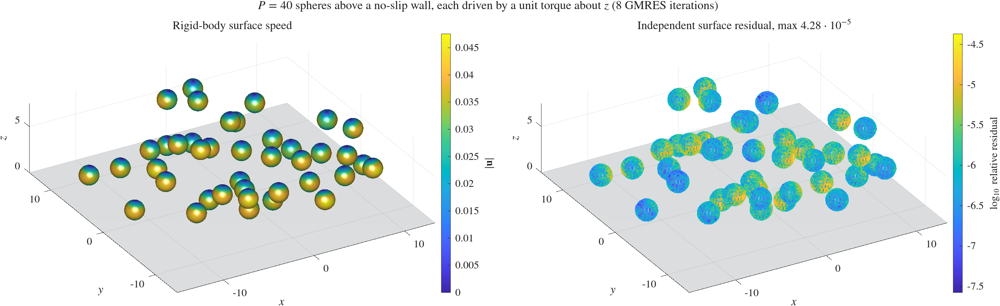
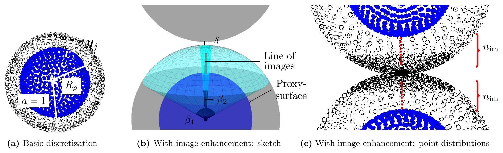
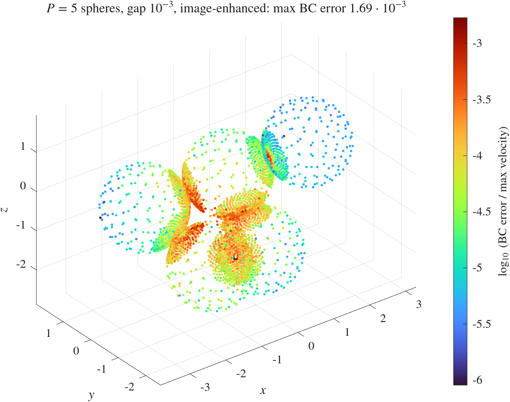
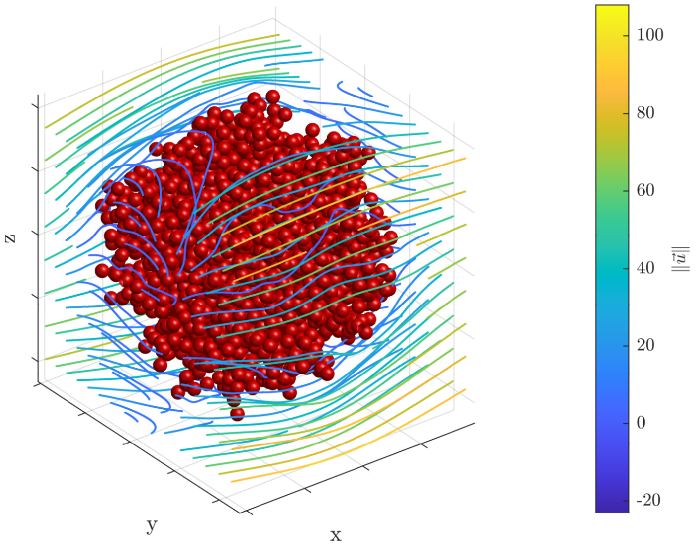

# StokesMFS3D

StokesMFS3D provides a minimal working implementation of the **Method of Fundamental Solutions (MFS)** for solving **Stokes resistance**, **mobility**, and **prescribed-slip mobility problems** for spherical or ellipsoidal rigid bodies. Equal spheres can also be solved above a planar no-slip wall using the Blake half-space Green function; see [wall-bounded Stokes](wall/README.md).

## Publications

This work is based on the following research papers:

1. **Accurate close interactions of Stokes spheres using lubrication-adapted image systems**  
   *A. Broms, A.H. Barnett, A.-K. Tornberg*, J. Comput. Phys. 523, 113636 (2025)  
   [https://doi.org/10.1016/j.jcp.2024.113636](https://doi.org/10.1016/j.jcp.2024.113636)

2. **A Method of Fundamental Solutions for Large-Scale 3D Elastance and Mobility Problems**  
   *A. Broms, A.H. Barnett, A.-K. Tornberg*, *Adv. Comput. Math.* (2025)  
   [https://doi.org/10.1007/s10444-025-10258-4](https://doi.org/10.1007/s10444-025-10258-4)

## Discretisations

Three discretisations are available:

- **Basic discretisation (proxy sources only):** used by `solve_resistance.m` and `solve_mobility.m`, and hence by `demo_spheres.m`, `demo_slip.m` and `ellipsoid_mobility_run.m`. It supports spheres and ellipsoids, FMM acceleration and prescribed slip, following [[2]](#publications).
- **Image-enhanced discretisation (spheres, resistance and mobility):** used by `solve_resistance_images.m` and `solve_mobility_images.m`, and hence by `demo_resistance_with_images.m`, `demo_cluster_resistance_with_images.m`, `demo_mobility_with_images.m` and `demo_cluster_mobility_with_images.m`. Image lines and extra collocation caps are added at each close contact, following [[1]](#publications). See [image resistance](images/README_resistance.md) and [image mobility](images/README_mobility.md).
- **Image-enhanced discretisation above a wall (spheres, resistance and mobility):** used by `solve_resistance_wall_images.m` and `solve_mobility_wall_images.m`. Image lines are added both at close sphere–wall contacts and at close sphere–sphere contacts, and every source includes its complete Blake wall correction. See [wall and close-pair image solvers](wall/README_images.md).

> **Note** With images, the discretisation of a sphere depends on its neighbours (gaps, contact directions and image counts). In the basic discretisation all identical spheres share one one-body matrix, which is factorised once. With images, the one-body matrix must be recomputed and refactorised for every unique discretisation, i.e. typically for every sphere that has close neighbours. Cross-sphere interactions are also summed directly, without FMM. The image solver is therefore considerably more expensive per sphere and is intended for close interactions. See `images/README_resistance.md`.

> **Accuracy note** In the current image-enhanced examples, one-body preconditioned mobility can have a larger independent surface residual than resistance. Dense SVD mobility has generally given higher surface accuracy, at substantially greater memory cost. A small GMRES residual alone does not establish surface accuracy; see [image mobility](images/README_mobility.md).

> **Note**: Without images, it is recommended to use a sufficiently large separation parameter `delta` between particles to ensure numerical accuracy.

## Features

- **Wall-bounded problems:** equal spheres above an infinite no-slip plane, using the Blake tensor and either wall-aware or free-space one-body preconditioning. See [wall-bounded Stokes](wall/README.md). Image-enhanced discretisations are also available in this setting, for spheres close to the wall and to each other; see [wall and close-pair image solvers](wall/README_images.md).
- **Resistance problem:** prescribe rigid-body velocities and compute forces and torques.
- **Mobility problem:** prescribe forces and torques and compute rigid-body velocities, optionally with prescribed surface slip.
  * Large scale suspensions of spheres or ellipsoidals simulated at low cost.
  * One-body preconditioning enables close-to-linear scaling via FMM acceleration. 
  *  On particle i, the generalized boundary condition is

```math
\mathbf{u}(\mathbf{x})
=
\mathbf{v}^{(i)}
+
\boldsymbol{\omega}^{(i)} \times (\mathbf{x}-\mathbf{c}^{(i)})
+
\mathbf{u}_{\mathrm{slip}}^{(i)}(\mathbf{x}).
```

## Dependencies

To run simulations, ensure the following dependencies are available:

- **[FMM3D, branch `faster_st3ddir`](https://github.com/annabroms/FMM3D/tree/faster_st3ddir)** (required, compiled with `make matlab`)  
  `st3ddir_opt` is only available on the `faster_st3ddir` branch of this fork, not on its `master` branch or in [upstream FMM3D](https://github.com/flatironinstitute/FMM3D). Clone it next to this repository with
  ```bash
  git clone -b faster_st3ddir https://github.com/annabroms/FMM3D.git
  ```
  Used for all free-space Stokeslet and stresslet sums in `getStokesletFlow.m` and `getStressletFlow.m`:
  - `stfmm3d` (`vars.fmm = true`): accelerated evaluation, recommended for many particles (typically >70 with default settings).
  - `st3ddir_opt` (`vars.fmm = false`): optimized compiled direct summation (velocity only) of Stokeslets and/or stresslets, parallelized with OpenMP. Inside MATLAB, the number of threads follows `maxNumCompThreads` (default: number of physical cores); `OMP_NUM_THREADS` has no effect.

  `setpath` adds `../FMM3D` when present. Small dense problems that build and apply a Stokeslet matrix explicitly do not use this routine.

  For a fast direct sum, build FMM3D with AVX2 and fast-math for the Stokes direct kernels (`stokkernels.f`) only, by adding to FMM3D's `make.inc`:
  ```make
  STOKDIRFLAGS = -march=x86-64-v3 -ffast-math
  ```
  then `rm -f src/Stokes/stokkernels.o && make matlab`. This makes the Stokeslet sum in `st3ddir_opt` about 3x faster than without these flags (for N = 10^3 to 2*10^4 sources and targets, 1 or 8 threads), with relative differences below 1e-14. With these flags, the stresslet sum in `st3ddir_opt` is 2–3x faster than the Stokes_Direct stresslet kernel. The FMM (`stfmm3d`) is not affected. The resulting MEX files require a CPU with AVX2 (x86-64 since ~2013–2017); leave the line out on older or non-x86 machines.

- **[StokesHalfspaceFMM](https://github.com/annabroms/StokesHalfspaceFMM)** (required only for wall-bounded Stokes solves)  
  The repository provides direct Blake and accelerated half-space evaluation. `setpath` adds its MATLAB package when present. Its `fmm` backend also requires a compiled FMM3D installation; direct Blake backends do not.

- **[Stokes_Direct](https://github.com/annabroms/Stokes_Direct)**  
  Used for compiled direct evaluation of tractions (`getTractionFast.m`), needed for e.g. slip and double-layer problems. Free-space Stokeslet and stresslet sums no longer use this repository. A precompiled binary is included in the `Stokes_Direct` repository.

To use your own method for accelerated or direct evaluation of Stokeslets, just modify the function getStokesletFlow.m.

- **Spherical Design Nodes**  
  Used to construct the source/target geometry. See `geometry/spheres/spherical_designs/README.md` for details.

- **[Memorygraph](https://github.com/ahbarnett/memorygraph)**
Used for profiling and checks on memory usage.

## Example
In the demo folder, we demonstrate the method using minimal input:
- Run `demo_spheres.m` to reproduce a basic simulation for spherical particles using the MFS.
- Run `demo_slip.m` for force- and torque-free spherical particles with prescribed surface slip.
- Run `ellipsoid_mobility_run.m` with no arguments for a mobility solve, followed by a resistance solve for a cluster of ellipsoidal particles.
- Run `demo_resistance_with_images.m` for a two-sphere resistance problem with lubrication-adapted image systems (see `images/README_resistance.md`).
- Run `demo_cluster_resistance_with_images.m` for a resistance problem with a cluster of close spheres using image systems.
- Run `demo_mobility_with_images.m` for the matching two-sphere resistance-to-mobility check.
- Run `demo_cluster_mobility_with_images.m` for the matching five-sphere cluster check.
- Run `demo_wall_mobility.m` for a wall-bounded mobility/resistance round trip, or `demo_random_wall_torque.m` for a random wall cluster under unit torques.

Many functions, including solve_mobility.m and solve_resistance.m, contain self-tests. When run without arguments, they execute an example simulation.

## Illustrations

**Ellipsoids.** Mobility problem for 100 ellipsoids (semi-axes 0.4, 0.6, 1) with minimum separation 0.5, coloured by the surface speed of the computed rigid-body motion. Produced by `ellipsoid_mobility_run(100,0.5,20,1,0,[],'')`, basic discretisation. This is a small version of the large-scale ellipsoid test (Example 4) in [[2]](#publications).

<p align="center"></p>

**Spheres above a wall.** 40 spheres above a no-slip wall, each driven by a unit torque about the wall normal, solved with the Blake tensor and FMM (`demo_random_wall_torque`). Left: surface speed of the computed rigid-body motion. Right: independent relative surface residual.



**Image-enhanced discretisation of a close pair.** Figure 2 of [[1]](#publications). (a) Basic discretisation: proxy sources $\boldsymbol y_j$ on a sphere of radius $R_p$ and collocation points $\boldsymbol x_i$ on the particle surface. (b) Sketch of the image enhancement: a line of images inside each sphere and collocation caps (angles $\beta_1$, $\beta_2$) around the point of closest approach at gap $\delta$. (c) The resulting point distributions, with $n_{\mathrm{im}}$ image points (red) per sphere.



**Close cluster with images.** Resistance problem for five spheres, most of them at gaps of $10^{-3}$, with random rigid-body velocities (`demo_cluster_resistance_with_images`). The colours show the independent boundary-condition error on the image-enhanced grids. Points are concentrated in the collocation caps at each contact.



**Large fixed cluster in shear flow.** Streamlines around a cluster of 2000 fixed spheres in a background shear flow, coloured by $\lVert\boldsymbol u\rVert$. From Figure 7 (shear-flow panel) of [[1]](#publications). Each sphere is at a gap of $\delta = 10^{-3}$ from at least one neighbour and is discretised with $N = 686$ proxy sources, about 4.8 million unknowns in total. No image points are needed, since the particles do not move relative to each other.

<p align="center"></p>

All figures except the two JCP figures can be regenerated with `tools/export_readme_figures.m`. It runs the demos unchanged and restyles their output with LaTeX-rendered labels.

## Roadmap

Planned additions include:

- A symmetrized version of the MFS solver to enable Brownian motion (in progress, see dev_DLP folders)
