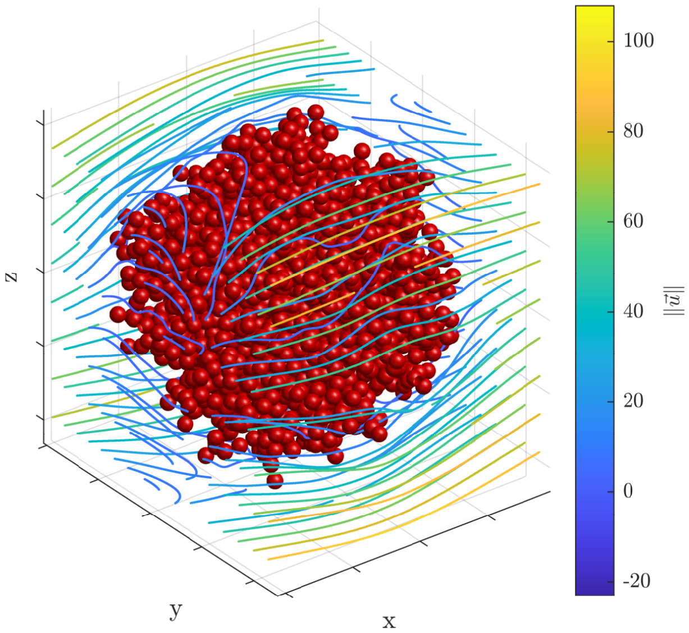
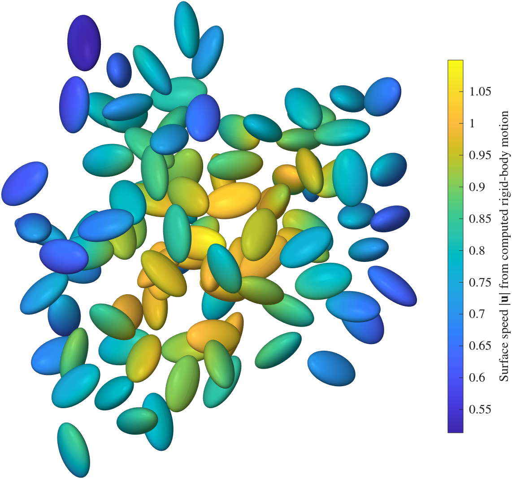

# StokesMFS3D

StokesMFS3D is a research code implementing the **Method of Fundamental Solutions (MFS)** for solving **Stokes resistance**, **mobility**, and **prescribed-slip mobility problems** for spherical or ellipsoidal rigid bodies. Equal spheres can also be solved above a planar no-slip wall using the Blake half-space Green function.

- **Resistance problem:** prescribe rigid-body velocities and compute net forces and torques.
- **Mobility problem:** prescribe forces and torques and compute rigid-body velocities, optionally with prescribed surface slip.
  * Large scale suspensions of spheres or ellipsoids simulated at low cost.
  * One-body preconditioning enables close-to-linear scaling via FMM acceleration. 
- **Wall-bounded problems:** equal spheres above an infinite no-slip plane, using the Blake tensor and either wall-aware or free-space one-body preconditioning. See [wall-bounded Stokes](wall/README.md). 

With prescribed slip, the boundary condition on particle $i$ is

```math
\mathbf{u}(\mathbf{x})
=
\mathbf{v}^{(i)}
+
\boldsymbol{\omega}^{(i)} \times (\mathbf{x}-\mathbf{c}^{(i)})
+
\mathbf{u}_{\mathrm{slip}}^{(i)}(\mathbf{x}).
```

## Publications

This work is primarily based on the following research papers:

1. **Accurate close interactions of Stokes spheres using lubrication-adapted image systems**  
   *A. Broms, A.H. Barnett, A.-K. Tornberg*, J. Comput. Phys. 523, 113636 (2025)  
   [https://doi.org/10.1016/j.jcp.2024.113636](https://doi.org/10.1016/j.jcp.2024.113636)

2. **A Method of Fundamental Solutions for Large-Scale 3D Elastance and Mobility Problems**  
   *A. Broms, A.H. Barnett, A.-K. Tornberg*, *Adv. Comput. Math.* (2025)  
   [https://doi.org/10.1007/s10444-025-10258-4](https://doi.org/10.1007/s10444-025-10258-4)

## Discretisations

Three discretisations are available:

- **Basic discretisation (proxy sources only)** [[2]](#publications): used by `solve_resistance.m` and `solve_mobility.m`, and hence by `demo_spheres.m`, `demo_slip.m` and `ellipsoid_mobility_run.m`. This supports spheres and ellipsoids, FMM acceleration and prescribed slip. For spheres, uniformly distributed proxy sources lie on an interior sphere of radius $R_p$ and uniformly distributed collocation points lie on the particle surface (panel (a) below). 
- **Image-enhanced discretisation (spheres, resistance and mobility)** [[1]](#publications): used by `solve_resistance_images.m` and `solve_mobility_images.m`, and hence by the `demo_*_with_images.m` demos. At each close contact, a line of image points is added inside each sphere, together with extra collocation points on caps around the point of closest approach (panels (b) and (c)). See [image resistance](images/README_resistance.md) and [image mobility](images/README_mobility.md).

  

  Figure 2 of [[1]](#publications) <sub>CC BY 4.0; see [LICENSE](LICENSE)</sub>: 
  (a) Proxy sources $\boldsymbol y_j$ and collocation points $\boldsymbol x_i$. (b) Line of images and collocation caps (angles $\beta_1$, $\beta_2$) at gap $\delta$. (c) Resulting point distributions, with $n_{\mathrm{im}}$ image points (red) per sphere.

- **Image-enhanced discretisation above a wall (spheres, resistance and mobility):** used by `solve_resistance_wall_images.m` and `solve_mobility_wall_images.m`. Image lines are added both at close sphere–wall contacts and at close sphere–sphere contacts, and every source includes its complete Blake wall correction. See [wall and close-pair image solvers](wall/README_images.md).

> **Note** With images, the discretisation of a sphere depends on its neighbours (gaps, contact directions and image counts). In the basic discretisation all identical spheres share one one-body matrix, which is factorised once and then used in ther iterative solve. With images, the one-body matrix must be recomputed and refactorised for every unique discretisation, i.e. typically for every sphere that has close neighbours. In the setting with images, cross-sphere interactions are also summed directly, without FMM acceleration and the number of GMRES unknowns is determined by a fine set of collocation nodes. The image solver is therefore considerably more expensive per sphere and is intended for smaller suspensions of close interactions.

> **Accuracy note** In the current image-enhanced examples, one-body preconditioned mobility can have a larger independent surface residual than resistance. A dense SVD mobility solve invovling all particles generally gives higher surface accuracy, but at substantially greater memory cost; see [image mobility](images/README_mobility.md).

> **Note**: Without images, it is recommended to use a sufficiently large separation parameter `delta` between particles or between particle and wall to ensure numerical accuracy.

## Dependencies

To run simulations, ensure the following dependencies are available:

- **[FMM3D, branch `faster_st3ddir`](https://github.com/annabroms/FMM3D/tree/faster_st3ddir)** (required, compiled with `make matlab`)  
  `st3ddir_opt` is only available on the `faster_st3ddir` branch of this fork, not on its `master` branch or in [upstream FMM3D](https://github.com/flatironinstitute/FMM3D). Clone it next to this repository with
  ```bash
  git clone -b faster_st3ddir https://github.com/annabroms/FMM3D.git
  ```
  Used for all free-space Stokeslet and stresslet sums in `getStokesletFlow.m` and `getStressletFlow.m`, and for Stokeslet tractions in `getTractionFast.m`:
  - `stfmm3d` (`vars.fmm = true`): accelerated evaluation, recommended for many particles (typically >70 with default settings).
  - `st3ddir_opt` (`vars.fmm = false`): optimized compiled direct summation of Stokeslet and/or stresslet velocities, and of Stokeslet tractions at targets with given normals (evaluated by their own kernel), parallelized with OpenMP. It uses MATLAB's thread count, which by default is the number of physical cores. To change it, call e.g. `maxNumCompThreads(4)` before solving; setting the environment variable `OMP_NUM_THREADS` does not change it.

  `setpath` adds `../FMM3D` when present. 
  
  >**Note:** For very small evaluations, a dense matrix-vector multiply is faster for evaluating a Stokeslet sum and does not use this routine.

  For a fast direct sum, build FMM3D with AVX2 and fast-math for the Stokes direct kernels (`stokkernels.f`) only, by adding to FMM3D's `make.inc`:
  ```make
  STOKDIRFLAGS = -march=x86-64-v3 -ffast-math
  ```
  then `rm -f src/Stokes/stokkernels.o && make matlab`. This makes the Stokeslet sum in `st3ddir_opt` about 3x faster than without these flags (for N = 10^3 to 2*10^4 sources and targets, 1 or 8 threads), with relative differences below 1e-14. With these flags, the stresslet sum in `st3ddir_opt` is 2–3x faster, and the traction in `getTractionFast.m` 2.5–3.4x faster, than the corresponding kernels of the former Stokes_Direct dependency. The FMM (`stfmm3d`) is not affected. The resulting MEX files require a CPU with AVX2 (x86-64 since ~2013–2017); leave the line out on older or non-x86 machines.

- **[StokesHalfspaceFMM](https://github.com/annabroms/StokesHalfspaceFMM)** (required only for wall-bounded Stokes solves)  
  The repository provides direct Blake and accelerated half-space evaluation. `setpath` adds its MATLAB package when present. Its `fmm` backend also requires a compiled FMM3D installation; direct Blake backends do not.

To use your own method for accelerated or direct evaluation of Stokeslets, just modify the function getStokesletFlow.m. 

- **Spherical Design Nodes**  
  Used to construct the source/target geometry. See `geometry/spheres/spherical_designs/README.md` for details.

- **[Memorygraph](https://github.com/ahbarnett/memorygraph)**
Used for profiling and checks on memory usage.

## Examples
In the demo folder, we demonstrate the method using minimal input:
- Run `demo_spheres.m` to reproduce a basic simulation for spherical particles using the MFS.
- Run `demo_slip.m` for force- and torque-free spherical particles with prescribed surface slip.
- Run `ellipsoid_mobility_run.m` with no arguments for a mobility solve, followed by a resistance solve for a cluster of ellipsoidal particles.
- Run `demo_resistance_with_images.m` for a two-sphere resistance problem with lubrication-adapted image systems (see `images/README_resistance.md`).
- Run `demo_cluster_resistance_with_images.m` for a resistance problem with a cluster of close spheres using image systems.
- Run `demo_mobility_with_images.m` for the matching two-sphere resistance-to-mobility check.
- Run `demo_cluster_mobility_with_images.m` for the matching five-sphere cluster check.
- Run `demo_wall_mobility.m` for a wall-bounded mobility/resistance round trip, or `demo_random_wall_torque.m` for a random wall cluster under unit torques.

Many functions, including solve_mobility.m and solve_resistance.m, contain self-tests. When run without arguments, they execute an example simulation.

## Illustrations

<table>
  <tr>
    <td align="center"></td>
    <td align="center"></td>
  </tr>
  <tr>
    <td valign="top"><b>Large fixed cluster in shear flow.</b> Streamlines around 2000 fixed spheres in a background shear flow, coloured by ‖<b>u</b>‖. From Figure 7 (shear-flow panel) of <a href="#publications">[1]</a> <sub>CC BY 4.0; see <a href="LICENSE">LICENSE</a></sub>. Each sphere is at a gap of δ = 10<sup>−3</sup> from at least one neighbour and is discretised with N = 686 proxy sources, about 4.8 million unknowns in total. No image points are needed, since the particles do not move relative to each other.</td>
    <td valign="top"><b>Ellipsoids.</b> Mobility problem for 100 ellipsoids (semi-axes 0.4, 0.6, 1) with minimum separation 0.5, coloured by the surface speed of the computed rigid-body motion. Produced by <code>ellipsoid_mobility_run(100,0.5,20,1,0,[],'')</code> with the basic discretisation; a small version of the large-scale ellipsoid test (Example 4) in <a href="#publications">[2]</a>.</td>
  </tr>
</table>

**Spheres above a wall.** 40 spheres above a no-slip wall, each driven by a unit torque about the wall normal, solved with the Blake tensor and FMM (`demo_random_wall_torque`). Left: surface speed of the computed rigid-body motion. Right: independent relative surface residual.


**Close cluster with images.** Resistance problem for five spheres, most of them at gaps of $10^{-3}$, with random rigid-body velocities (`demo_cluster_resistance_with_images`). The colours show the independent boundary-condition error on clustered surface nodes in the near contact regions. 

<p align="center"></p>

All figures except the two JCP figures can be regenerated with `tools/export_readme_figures.m`. It runs the demos unchanged and restyles their output with LaTeX-rendered labels.

## Roadmap

Planned additions include:

- A symmetrized version of the MFS solver to enable Brownian motion (in progress, see dev_DLP folders)
- A two-body preconditioned solver, as in [StokesMFS2D](https://github.com/annabroms/StokesMFS2D), where pair corrections (and their compressed "peanut" variant) reduce both the number of GMRES unknowns and iterations compared with one-body preconditioning.
