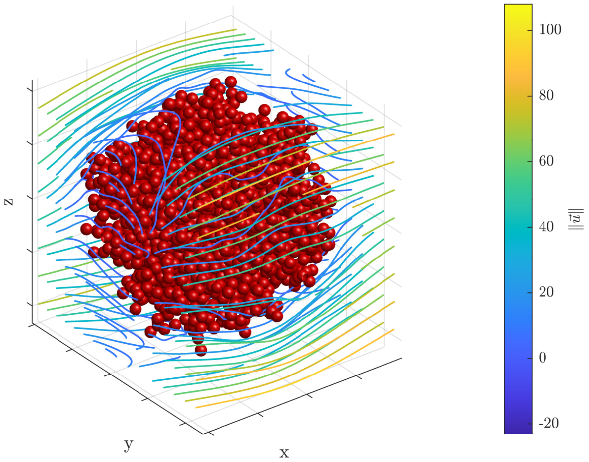

# StokesMFS3D

StokesMFS3D provides a minimal working implementation of the **Method of Fundamental Solutions (MFS)** for solving **Stokes resistance**, **mobility**, and **prescribed-slip mobility problems** for spherical or ellipsoidal rigid bodies. Equal spheres can also be solved above a planar no-slip wall using the Blake half-space Green function; see [wall-bounded Stokes](wall/README.md).

Two discretisations are available:

- **Basic discretisation (proxy sources only):** used by `solve_resistance.m` and `solve_mobility.m`, and hence by `demo_spheres.m`, `demo_slip.m` and `ellipsoid_mobility_run.m`. It supports spheres and ellipsoids, FMM acceleration and prescribed slip.
- **Image-enhanced discretisation (spheres, resistance and mobility):** used by `solve_resistance_with_images.m` and `solve_mobility_with_images.m`, and hence by `demo_resistance_with_images.m`, `demo_cluster_resistance_with_images.m`, `demo_mobility_with_images.m` and `demo_cluster_mobility_with_images.m`. Image lines and extra collocation caps are added at each close contact, following [Broms et al. (2025)](#publications). See [image resistance](images/README_resistance.md) and [image mobility](images/README_mobility.md).

> **Note** With images, the discretisation of a sphere depends on its neighbours (gaps, contact directions and image counts). In the basic discretisation all identical spheres share one one-body matrix, which is factorised once. With images, the one-body matrix must be recomputed and refactorised for every unique discretisation, i.e. typically for every sphere that has close neighbours. Cross-sphere interactions are also summed directly, without FMM. The image solver is therefore considerably more expensive per sphere and is intended for close interactions. See `images/README_resistance.md`.

> **Accuracy note** In the current image-enhanced examples, one-body preconditioned mobility can have a larger independent surface residual than resistance. Dense SVD mobility has generally given higher surface accuracy, at substantially greater memory cost. A small GMRES residual alone does not establish surface accuracy; see [image mobility](images/README_mobility.md).

> **Note**: Without images, it is recommended to use a sufficiently large separation parameter `delta` between particles to ensure numerical accuracy.

## Features

- **Wall-bounded problems:** equal spheres above an infinite no-slip plane, using the Blake tensor and either wall-aware or free-space one-body preconditioning. See [wall-bounded Stokes](wall/README.md).
- **Resistance problem:** prescribe rigid-body velocities and compute forces and torques.
- **Mobility problem:** prescribe forces and torques and compute rigid-body velocities, optionally with prescribed surface slip.
  * Large scale suspensions of spheres or ellipsoidals simulated at low cost.
  * One-body preconditioning enables close-to-linear scaling via FMM acceleration. 
  *  On particle i, the generalized boundary condition is

```math
\mathbf{u}(\mathbf{x})
=
\mathbf{v}^{(i)}
+
\boldsymbol{\omega}^{(i)} \times (\mathbf{x}-\mathbf{c}^{(i)})
+
\mathbf{u}_{\mathrm{slip}}^{(i)}(\mathbf{x}).
```


  

## Dependencies

To run simulations, ensure the following dependencies are available:

- **[FMM3D](https://github.com/flatironinstitute/FMM3D)**  
  Recommended for accelerating calculations with many particles (typically >70 with default settings)

- **StokesHalfspaceFMM** (required for wall-bounded Stokes solves)  
  The sibling repository `../StokesHalfspaceFMM` provides direct Blake and accelerated half-space evaluation. `setpath` adds its MATLAB package when present. Its `fmm` backend also requires a compiled FMM3D installation; direct Blake backends do not.

- **[Stokes_Direct](https://github.com/annabroms/Stokes_Direct)**  
  Used for direct evaluation of fundamental solutions.  
  Only `SE0P_Stokeslet_direct.c` needs to be compiled in the standard setting. A precompiled binary is included in the `Stokes_Direct` repository.

To use your own method for accelerated or direct evaluation of Stokeslets, just modify the function getStokesletFlow.m.

- **Spherical Design Nodes**  
  Used to construct the source/target geometry. See `geometry/spheres/spherical_designs/README.md` for details.

- **[Memorygraph](https://github.com/ahbarnett/memorygraph)**
Used for profiling and checks on memory usage.

## Example
In the demo folder, we demonstrate the method using minimal input:
- Run `demo_spheres.m` to reproduce a basic simulation for spherical particles using the MFS.
- Run `demo_slip.m` for force- and torque-free spherical particles with prescribed surface slip.
- Run `ellipsoid_mobility_run.m` with no arguments for a mobility solve, followed by a resistance solve for a cluster of ellipsoidal particles.
- Run `demo_resistance_with_images.m` for a two-sphere resistance problem with lubrication-adapted image systems (see `images/README_resistance.md`).
- Run `demo_cluster_resistance_with_images.m` for a resistance problem with a cluster of close spheres using image systems.
- Run `demo_mobility_with_images.m` for the matching two-sphere resistance-to-mobility check.
- Run `demo_cluster_mobility_with_images.m` for the matching five-sphere cluster check.
- Run `demo_wall_mobility.m` for a wall-bounded mobility/resistance round trip, or `demo_random_wall_torque.m` for a random wall cluster under unit torques.

Several functions, including solve_mobility.m and solve_resistance.m, contain self-tests. When run without arguments, they execute an example simulation.
## Publications

This work is based on the following research papers:

1. **Accurate close interactions of Stokes spheres using lubrication-adapted image systems**  
   *A. Broms, A.H. Barnett, A.-K. Tornberg*, J. Comput. Phys. (2024)  
   [https://doi.org/10.1016/j.jcp.2024.113636](https://doi.org/10.1016/j.jcp.2024.113636)

2. **A Method of Fundamental Solutions for Large-Scale 3D Elastance and Mobility Problems**  
   *A. Broms, A.H. Barnett, A.-K. Tornberg*, *Adv. Comput. Math.* (2025)  
   [https://doi.org/10.1007/s10444-025-10258-4](https://doi.org/10.1007/s10444-025-10258-4) 




## Roadmap

Planned additions include:

- A symmetrized version of the MFS solver to enable Brownian motion (in progress, see dev_DLP folders)
